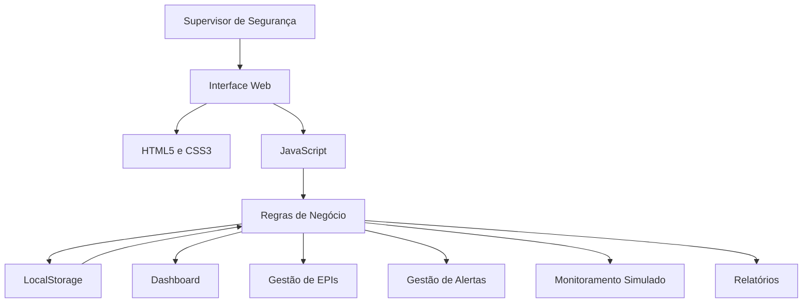
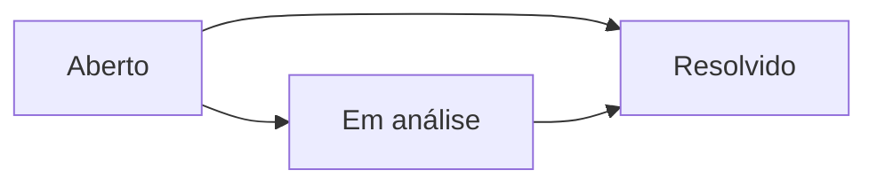
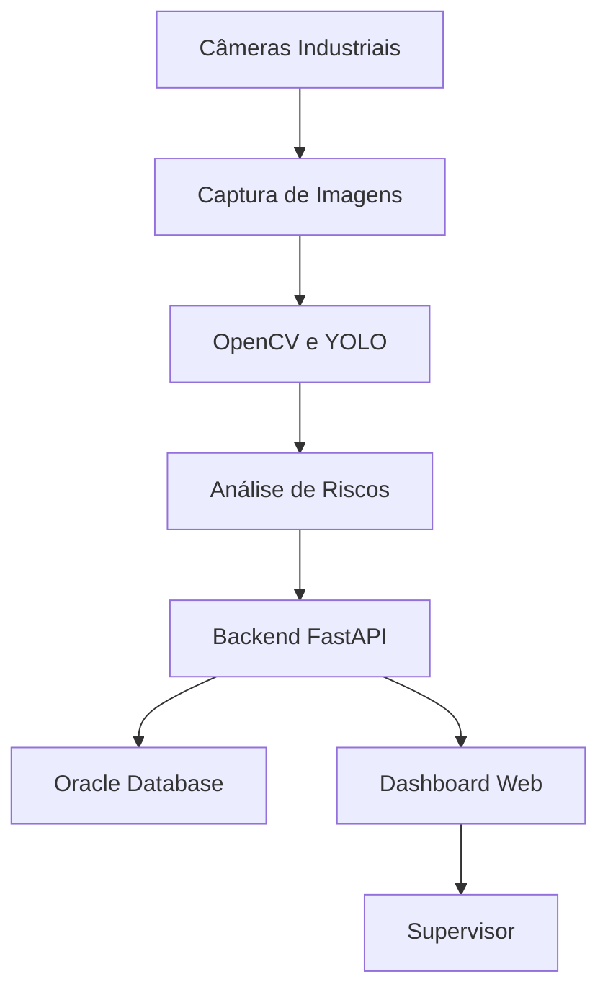

# 🏗️ Arquitetura Final — SPI Alert | FutureVision

## Challenge de Engenharia de Software — Sprint 4

**Projeto:** SPI Alert — FutureVision  
**Cliente:** Metaindústria  
**Parceiro:** SPI Integração  
**Entrega:** Arquitetura Final da Solução

---

# 1. Visão Geral do Sistema

O SPI Alert é uma aplicação web demonstrativa desenvolvida para apoiar o gerenciamento de Equipamentos de Proteção Individual (EPIs) e o acompanhamento de ocorrências de segurança industrial.

A solução centraliza registros de equipamentos, alertas e indicadores em uma interface acessível pelo navegador.

O projeto foi desenvolvido de maneira evolutiva durante quatro Sprints, partindo da identificação do problema até a implementação de funcionalidades interativas.

## 1.1 Problema Abordado

A gestão de segurança industrial depende do acompanhamento de colaboradores, equipamentos e situações de risco.

A ausência de informações centralizadas pode dificultar a identificação de irregularidades, o controle dos EPIs e a análise de ocorrências.

## 1.2 Objetivo da Arquitetura

Estabelecer uma estrutura tecnológica que permita:

- Gerenciar registros de EPIs.
- Consultar validade e condições dos equipamentos.
- Registrar ocorrências de segurança.
- Acompanhar o status dos alertas.
- Visualizar indicadores operacionais.
- Simular o monitoramento de setores industriais.
- Produzir relatórios demonstrativos.

---

# 2. Arquitetura da Aplicação Final

## 2.1 Modelo Arquitetural

A versão final demonstrativa utiliza uma arquitetura web executada no próprio navegador, baseada em HTML5, CSS3 e JavaScript.

Os dados são armazenados localmente por meio da API LocalStorage.

A aplicação não depende de um servidor backend para executar os fluxos implementados.

## 2.2 Diagrama da Arquitetura

## 2.3 Fluxo de Funcionamento

1. O usuário acessa o arquivo HTML pelo navegador.
2. A aplicação solicita uma matrícula e uma senha para acesso demonstrativo.
3. O JavaScript disponibiliza as telas e funcionalidades.
4. Os formulários permitem registrar EPIs e ocorrências.
5. As regras de negócio processam os dados informados.
6. Os registros são armazenados no LocalStorage.
7. O sistema atualiza listagens e indicadores.
8. O usuário pode consultar informações e gerar relatórios.

---

# 3. Stack Tecnológica

## 3.1 Tecnologias Implementadas

| Tecnologia | Aplicação |
|---|---|
| HTML5 | Estrutura e organização das telas |
| CSS3 | Estilização, layout e responsividade |
| JavaScript | Funcionalidades e regras de negócio |
| LocalStorage | Persistência dos registros demonstrativos |
| SessionStorage | Controle da sessão demonstrativa |
| Git | Controle de versões |
| GitHub | Repositório e documentação |
| Trello | Organização das atividades Scrum |

## 3.2 Justificativas Técnicas

### HTML5

Escolhido para estruturar formulários, tabelas, menus e telas de forma compatível com navegadores modernos.

### CSS3

Utilizado para manter uma interface consistente, com componentes reutilizáveis e adaptação a diferentes resoluções.

### JavaScript

Responsável pela execução das funcionalidades, incluindo:

- Navegação entre telas.
- Validação básica de formulários.
- Cadastro de EPIs.
- Classificação dos equipamentos.
- Emissão de alertas.
- Atualização do status das ocorrências.
- Cálculo de indicadores.
- Filtragem e apresentação de registros.

### LocalStorage

Escolhido para permitir persistência local dos dados sem necessidade de servidor ou banco de dados externo.

Essa decisão facilita a demonstração acadêmica e a execução imediata da aplicação.

### SessionStorage

Utilizado para manter a sessão demonstrativa enquanto o navegador conserva o armazenamento da aba.

**Importante:** o controle de sessão não equivale a uma autenticação segura de produção.

---

# 4. Componentes do Sistema

## 4.1 Módulo de Acesso

Apresenta o formulário de matrícula e senha.

Na versão demonstrativa, o acesso é liberado mediante o preenchimento dos campos.

**Limitação:** não existe validação de credenciais em servidor.

## 4.2 Dashboard Operacional

Consolida indicadores obtidos dos registros disponíveis:

- Alertas ativos.
- Percentual de EPIs regulares.
- Colaboradores cadastrados.
- Câmeras cadastradas.
- Histórico recente de ocorrências.

Os indicadores são recalculados após mudanças nos registros.

## 4.3 Gestão de EPIs

Responsável pelo cadastro e pela consulta dos equipamentos de proteção.

### Dados Registrados

- Identificador do registro.
- Identificador do colaborador.
- Tipo de equipamento.
- Número do Certificado de Aprovação (CA).
- Data de validade.
- Condição do equipamento.

### Regras de Classificação

Os equipamentos são classificados conforme a condição e a validade:

- **Regular:** equipamento não danificado, com validade superior a 30 dias.
- **Vencendo:** equipamento não danificado, com vencimento em até 30 dias.
- **Irregular:** equipamento danificado ou com validade expirada.

Essa classificação representa uma regra demonstrativa simplificada e não substitui avaliações técnicas de segurança do trabalho.

## 4.4 Gestão de Alertas

Permite registrar e acompanhar ocorrências relacionadas à segurança industrial.

### Dados Registrados

- Identificador da ocorrência.
- Tipo de risco.
- Severidade.
- Setor.
- Câmera associada.
- Descrição.
- Status.
- Data e horário.

### Estados dos Alertas

O sistema permite atualizar os alertas pendentes para **Em análise** ou **Resolvido**.

As modificações são armazenadas localmente.

## 4.5 Monitoramento Industrial

Apresenta quatro câmeras cadastradas para demonstrar o acompanhamento de setores da Metaindústria:

| Câmera | Local |
|---|---|
| CAM-001 | Almoxarifado |
| CAM-003 | Linha de Produção 3 |
| CAM-005 | Laboratório Químico |
| CAM-007 | Setor B |

O módulo consulta os alertas associados a cada câmera e apresenta a quantidade de ocorrências ativas.

**Não existe transmissão de vídeo ao vivo nem processamento automático de imagens nesta versão.**

## 4.6 Relatórios

Consolida informações dos registros armazenados:

- Total de EPIs.
- EPIs regulares.
- EPIs irregulares.
- Alertas pendentes.
- Alertas resolvidos.

O usuário pode imprimir o relatório ou utilizar a opção de salvar como PDF disponível no navegador.

O recurso de e-mail prepara uma mensagem por meio do aplicativo configurado no dispositivo; não realiza envio automático.

---

# 5. Modelo de Dados

## 5.1 Estrutura Geral

A aplicação mantém duas coleções principais de registros:

- EPIs.
- Alertas.

Também utiliza listas demonstrativas de colaboradores e câmeras.

## 5.2 Entidade EPI

| Campo | Descrição |
|---|---|
| id | Identificador do registro |
| colab | Identificador do colaborador |
| tipo | Equipamento cadastrado |
| ca | Número do Certificado de Aprovação |
| validade | Data de validade |
| condicao | Condição informada |

## 5.3 Entidade Alerta

| Campo | Descrição |
|---|---|
| id | Identificador da ocorrência |
| tipo | Tipo de risco |
| severidade | Nível de risco |
| setor | Local da ocorrência |
| camera | Câmera associada |
| descricao | Descrição do evento |
| status | Situação do alerta |
| data | Data e horário do registro |

## 5.4 Persistência

Os registros são serializados em JSON e armazenados no LocalStorage do navegador.

Quando um novo cadastro ou alteração de status ocorre, a aplicação atualiza os dados persistidos.

### Limitações

- Não existe sincronização entre computadores.
- Os dados podem ser apagados pela limpeza do navegador.
- Não há controle de acesso individual aos registros.
- Não existe banco de dados corporativo.
- Não há garantia de integridade transacional equivalente à de um banco de dados.

---

# 6. Evolução da Arquitetura nas Quatro Sprints

## 6.1 Sprint 1 — Concepção

A primeira Sprint concentrou-se na compreensão do problema e na definição inicial da solução.

### Decisões

- Propor um sistema de apoio à prevenção de riscos industriais.
- Considerar visão computacional como possibilidade tecnológica.
- Identificar os principais processos de gestão de EPIs.
- Estruturar a proposta inicial de arquitetura.

## 6.2 Sprint 2 — Modelagem e Refinamento

A segunda Sprint aprofundou a organização dos requisitos e dos fluxos do sistema.

### Decisões

- Refinar as interfaces.
- Melhorar a organização da informação.
- Detalhar os principais casos de uso.
- Evoluir a documentação de requisitos e diagramas.

## 6.3 Sprint 3 — Protótipo Interativo

A terceira Sprint concentrou-se na evolução do protótipo e na gestão ágil do desenvolvimento.

### Decisões

- Incorporar a experiência de login.
- Ampliar os fluxos de navegação.
- Introduzir monitoramento demonstrativo.
- Refinar filtros e formulários.
- Organizar o acompanhamento pelo Trello.

## 6.4 Sprint 4 — Aplicação Demonstrativa Funcional

A quarta Sprint priorizou o funcionamento dos principais fluxos, a persistência dos registros e a consolidação da documentação.

### Decisões

- Manter a execução da aplicação no navegador.
- Utilizar JavaScript para implementar as regras de negócio.
- Adotar LocalStorage para armazenar registros.
- Utilizar dados simulados coerentes com o contexto industrial.
- Implementar a gestão do status de alertas.
- Calcular indicadores a partir dos dados cadastrados.
- Disponibilizar relatórios demonstrativos.

### Justificativa da Arquitetura Final

A arquitetura escolhida permite demonstrar os fluxos essenciais do SPI Alert sem depender de infraestrutura externa.

É adequada para validação acadêmica de funcionalidades e experiência de uso.

Entretanto, uma implantação industrial real exigiria componentes adicionais de segurança, integração, disponibilidade e processamento.

---

# 7. Arquitetura Evolutiva Proposta

O projeto FutureVision considera a possibilidade de integrar inteligência artificial e visão computacional em versões futuras.

## 7.1 Arquitetura Conceitual

## 7.2 Tecnologias Futuras

### Python

Possível linguagem para processamento de imagens e integração de modelos de inteligência artificial.

### OpenCV

Biblioteca considerada para captura e tratamento de imagens.

### YOLOv8

Modelo considerado para detecção de objetos, incluindo equipamentos de proteção.

### MediaPipe

Ferramenta considerada para análise de postura e movimento.

### FastAPI

Tecnologia considerada para comunicação entre os componentes de inteligência artificial, banco de dados e interface.

### Oracle Database

Banco de dados considerado para armazenamento centralizado dos registros industriais.

**Esses componentes pertencem à arquitetura proposta e não foram implementados na versão HTML da Sprint 4.**

---

# 8. Decisões e Trade-offs

| Decisão | Benefício | Limitação |
|---|---|---|
| Aplicação em HTML, CSS e JavaScript | Execução simples | Sem backend corporativo |
| LocalStorage | Persistência sem servidor | Dados restritos ao navegador |
| Dados simulados | Demonstração independente | Não representam eventos reais |
| Monitoramento simulado | Visualização de ocorrências | Sem transmissão de câmeras |
| Interface web | Acesso por navegadores | Depende do ambiente do usuário |
| Relatórios no navegador | Exportação simplificada | Sem serviço centralizado de relatórios |

---

# 9. Segurança e Restrições

A versão demonstrativa não deve ser utilizada como sistema de segurança industrial em produção.

Antes de uma implantação real, seriam necessários:

- Autenticação segura de usuários.
- Controle de acesso por perfil.
- Backend com validação das operações.
- Banco de dados centralizado.
- Registro de auditoria das alterações.
- Proteção dos dados pessoais.
- Comunicação segura entre serviços.
- Monitoramento de disponibilidade.
- Testes de desempenho e confiabilidade.
- Validação dos modelos de detecção de riscos.
- Revisão dos requisitos legais e operacionais de segurança do trabalho.

---

# 10. Execução da Aplicação

## 10.1 Pré-requisitos

- Navegador atualizado.
- Arquivos do projeto disponíveis localmente.

Não é necessária instalação de servidor.

## 10.2 Instruções

1. Acessar o repositório GitHub.
2. Baixar o projeto.
3. Extrair os arquivos.
4. Localizar `spi-prototipo.html`.
5. Abrir o arquivo no navegador.
6. Informar matrícula e senha não vazias.
7. Navegar pelos módulos do sistema.

## 10.3 Repositório

[GitHub — SPI Alert FutureVision](https://github.com/joao-baldini/Challenge-Sprint-1-Engenharia-de-Sofware)

---

# 11. Documentação Relacionada

| Documento | Conteúdo |
|---|---|
| [README.md](README.md) | Visão geral e instruções de uso |
| [REQUISITOS.md](REQUISITOS.md) | Requisitos e personas |
| [DIAGRAMAS.md](DIAGRAMAS.md) | Diagramas de modelagem |
| [CERIMONIAS_SCRUM.md](CERIMONIAS_SCRUM.md) | Registros Scrum |
| [spi-prototipo.html](spi-prototipo.html) | Código da aplicação |

---

# 12. Conclusão

A arquitetura final do SPI Alert representa a evolução do projeto FutureVision ao longo de quatro Sprints.

O desenvolvimento partiu da análise do problema industrial, passou pela modelagem e pelo protótipo interativo e chegou a uma aplicação demonstrativa com fluxos funcionais e armazenamento local.

A solução apresenta uma base para gerenciamento de EPIs, acompanhamento de alertas, visualização de indicadores e relatórios.

A arquitetura mantém possibilidades de evolução para um ambiente corporativo com backend, banco de dados centralizado, câmeras industriais e inteligência artificial.

**SPI Alert — FutureVision: tecnologia aplicada ao apoio à prevenção de riscos industriais.**
