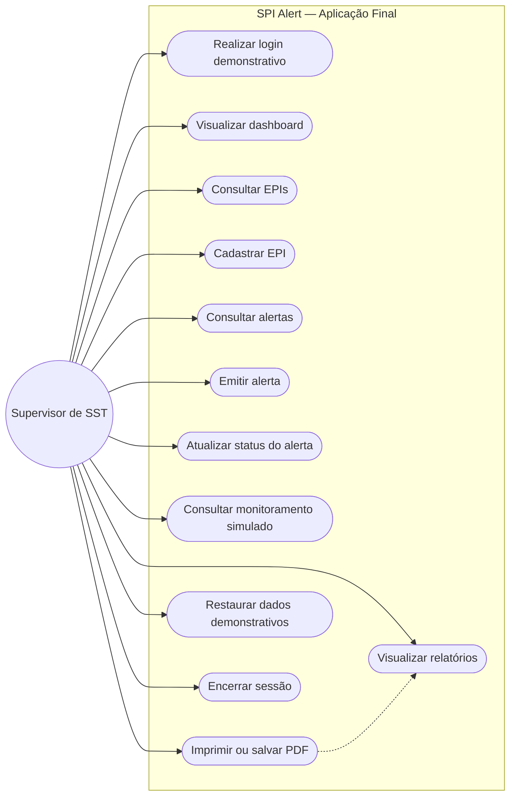
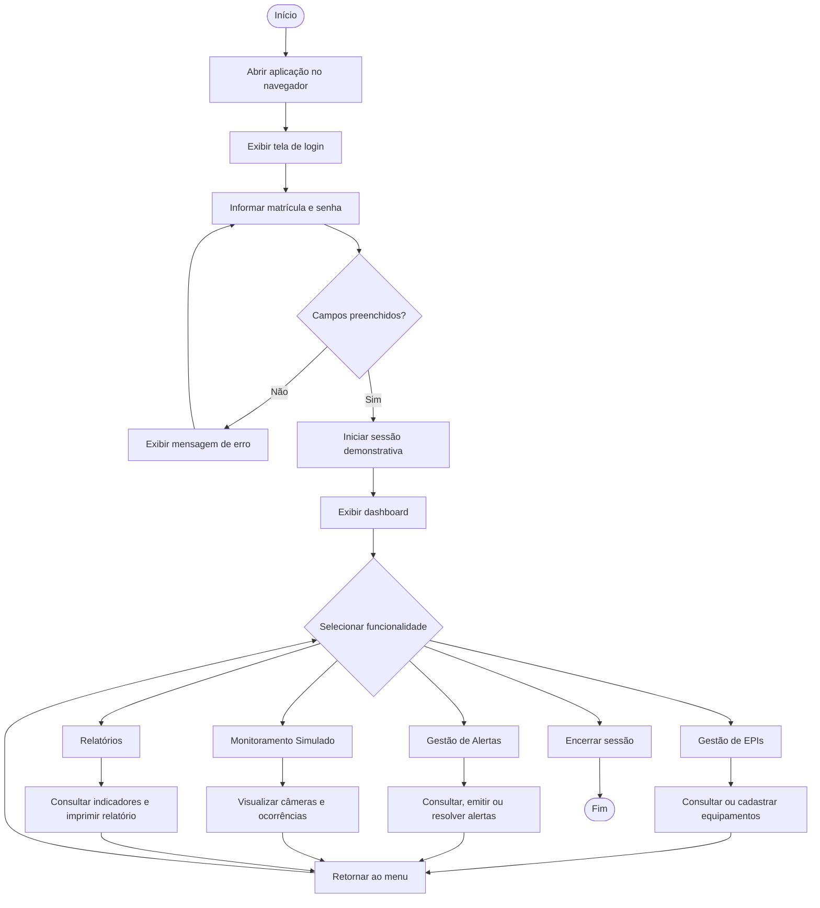
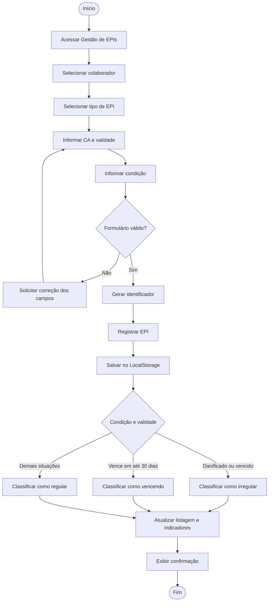
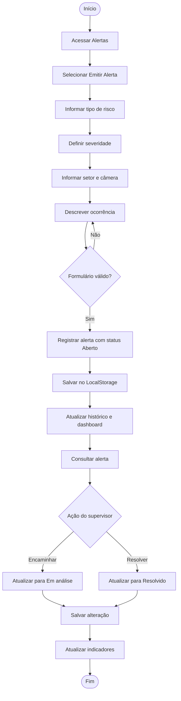
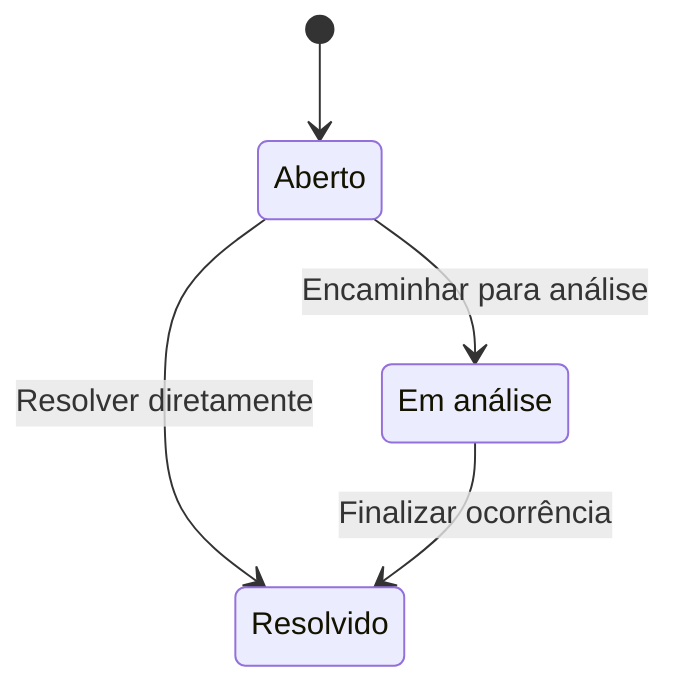
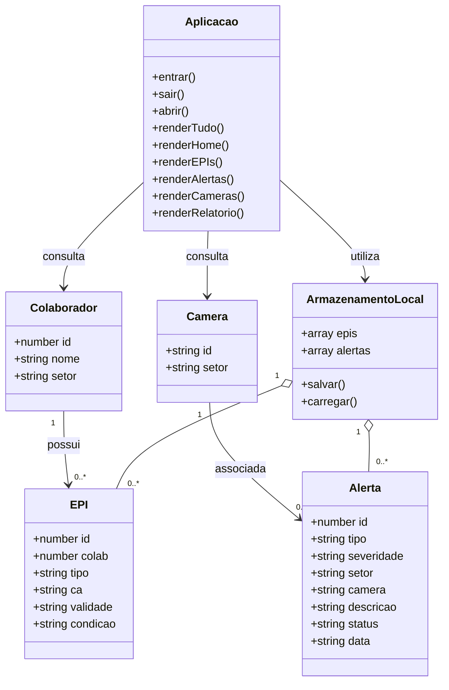
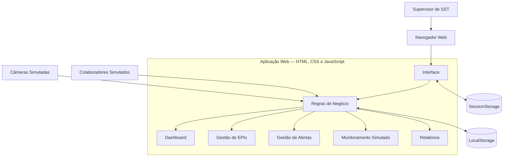
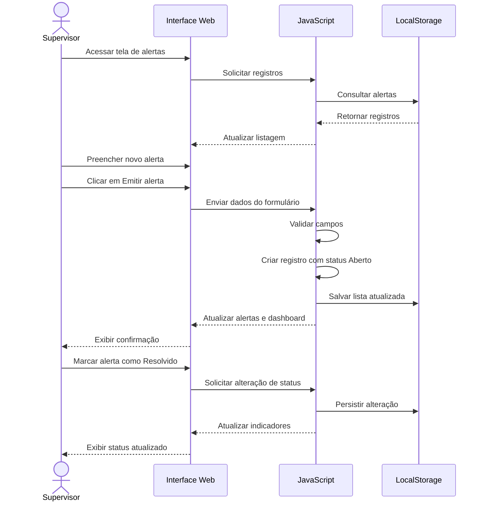
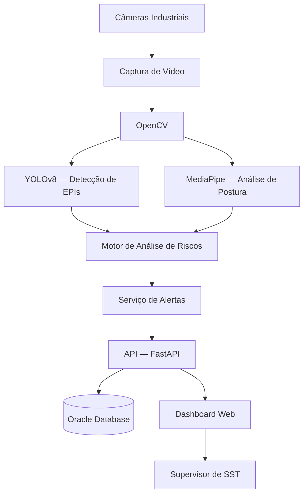

# 🗺️ Diagramas UML e Arquitetura — SPI Alert | FutureVision

## Challenge de Engenharia de Software — Sprints 1, 2, 3 e 4

**Projeto:** SPI Alert — FutureVision  
**Contexto:** Metaindústria  
**Entrega:** Sprint 4 — Aplicação Final

---

# 1. Introdução

Este documento apresenta a modelagem do sistema SPI Alert — FutureVision e sua evolução ao longo das quatro Sprints do projeto.

O objetivo é representar os principais atores, funcionalidades, fluxos operacionais, estruturas de dados e componentes tecnológicos da solução.

A documentação diferencia:

- **Arquitetura implementada:** aplicação web com HTML, CSS, JavaScript e armazenamento local.
- **Arquitetura evolutiva:** proposta futura de integração com câmeras industriais, inteligência artificial, APIs e banco de dados corporativo.

Essa distinção permite demonstrar a evolução do projeto sem confundir os recursos planejados com aqueles efetivamente desenvolvidos.

---

# 2. Diagrama de Casos de Uso — Sprint 4

## 2.1 Objetivo

Representar as funcionalidades disponíveis para o supervisor de segurança na aplicação final.

O supervisor é o principal ator do sistema.

## 2.2 Diagrama

## 2.3 Descrição dos Casos de Uso

| Código | Caso de Uso | Resultado Esperado |
|---|---|---|
| UC01 | Login demonstrativo | Liberar acesso com campos preenchidos |
| UC02 | Visualizar dashboard | Apresentar indicadores operacionais |
| UC03 | Consultar EPIs | Exibir e pesquisar equipamentos cadastrados |
| UC04 | Cadastrar EPI | Adicionar registro ao armazenamento local |
| UC05 | Consultar alertas | Exibir ocorrências e respectivos status |
| UC06 | Emitir alerta | Registrar nova ocorrência |
| UC07 | Atualizar alerta | Alterar situação da ocorrência |
| UC08 | Monitoramento | Exibir câmeras e alertas associados |
| UC09 | Relatórios | Consolidar indicadores dos registros |
| UC10 | Exportar relatório | Utilizar a impressão ou salvar como PDF |
| UC11 | Restaurar dados | Recuperar base demonstrativa inicial |
| UC12 | Encerrar sessão | Retornar à tela de login |

**Observação:** o sistema não realiza identificação automática de riscos por inteligência artificial nesta versão.

---

# 3. Diagrama de Atividades — Fluxo de Acesso e Navegação

## 3.1 Objetivo

Representar o processo de acesso à aplicação e utilização dos módulos disponíveis.

## 3.2 Diagrama

## 3.3 Regras do Fluxo

- A matrícula e a senha precisam estar preenchidas.
- O acesso é demonstrativo, sem autenticação em servidor.
- O supervisor pode navegar entre os módulos.
- Os cadastros e atualizações são processados pelo JavaScript.
- A sessão pode ser encerrada pelo usuário.

---

# 4. Diagrama de Atividades — Cadastro de EPI

## 4.1 Objetivo

Representar o funcionamento do cadastro e da classificação de Equipamentos de Proteção Individual.

## 4.2 Diagrama

## 4.3 Regras de Negócio

### EPI Regular

Equipamento não danificado e com validade superior a 30 dias.

### EPI Vencendo

Equipamento não danificado com vencimento nos próximos 30 dias.

### EPI Irregular

Equipamento com validade expirada ou condição informada como danificada.

Essa classificação é simplificada para fins acadêmicos e não substitui os procedimentos reais de segurança do trabalho.

---

# 5. Diagrama de Atividades — Gestão de Alertas

## 5.1 Objetivo

Representar o ciclo de registro e acompanhamento de uma ocorrência de segurança.

## 5.2 Diagrama

## 5.3 Estados de uma Ocorrência

## 5.4 Classificação de Severidade

Os alertas podem ser classificados como:

- Crítico.
- Alto.
- Médio.
- Baixo.

A severidade é informada pelo supervisor durante o registro demonstrativo.

---

# 6. Diagrama de Classes — Modelo Lógico da Sprint 4

## 6.1 Objetivo

Representar as principais entidades de informação da aplicação.

Como o código utiliza objetos JavaScript, o diagrama abaixo é uma **representação lógica dos dados**, e não a descrição de classes JavaScript implementadas.

## 6.2 Diagrama

## 6.3 Descrição das Entidades

### Colaborador

Representa um profissional cadastrado na base demonstrativa.

Possui identificador, nome e setor.

### EPI

Representa o equipamento registrado para determinado colaborador.

Armazena tipo, CA, validade e condição.

### Alerta

Representa uma ocorrência de risco registrada na aplicação.

Armazena severidade, localização, câmera, descrição, status e data.

### Câmera

Representa um ponto de monitoramento industrial simulado, identificado por código e setor.

### Armazenamento Local

Representa o armazenamento de registros de EPIs e alertas no navegador.

### Aplicação

Representa as funções JavaScript responsáveis pela navegação, regras de negócio e atualização da interface.

---

# 7. Diagrama de Arquitetura — Aplicação Implementada

## 7.1 Objetivo

Demonstrar a organização técnica da aplicação entregue na Sprint 4.

## 7.2 Diagrama

## 7.3 Componentes

| Componente | Responsabilidade |
|---|---|
| HTML5 | Estrutura das telas e formulários |
| CSS3 | Estilização e responsividade |
| JavaScript | Navegação e regras de negócio |
| LocalStorage | Persistência dos EPIs e alertas |
| SessionStorage | Sessão demonstrativa |
| Dados simulados | Colaboradores e câmeras de exemplo |
| Navegador | Ambiente de execução |

## 7.4 Características

- Aplicação executada diretamente no navegador.
- Não exige instalação de backend.
- Não utiliza banco de dados corporativo.
- Mantém dados de EPIs e alertas localmente.
- Não sincroniza informações entre dispositivos.
- Não processa imagens industriais.

---

# 8. Diagrama de Sequência — Registro de Alerta

## 8.1 Objetivo

Demonstrar a interação entre supervisor, interface, regras de negócio e armazenamento local.

## 8.2 Diagrama

---

# 9. Diagrama de Arquitetura Evolutiva — Visão Futura

## 9.1 Objetivo

Preservar a concepção original do FutureVision, baseada em inteligência artificial e visão computacional.

Essa arquitetura representa uma possível evolução do projeto, não a implementação entregue na Sprint 4.

## 9.2 Diagrama

## 9.3 Tecnologias da Arquitetura Proposta

| Tecnologia | Finalidade Prevista |
|---|---|
| Python | Processamento e integração |
| OpenCV | Captura e tratamento de imagens |
| YOLOv8 | Identificação de objetos e EPIs |
| MediaPipe | Análise de postura corporal |
| FastAPI | Comunicação por API |
| Oracle Database | Armazenamento centralizado |
| React ou Streamlit | Interface de monitoramento |

## 9.4 Diferenças em Relação à Aplicação Atual

| Recurso | Sprint 4 | Evolução Futura |
|---|---|---|
| Cadastro de EPIs | Funcional | Integrado ao banco corporativo |
| Alertas | Registro manual | Detecção automática por IA |
| Dashboard | Dados locais | Dados centralizados |
| Monitoramento | Câmeras simuladas | Vídeo industrial real |
| Persistência | LocalStorage | Oracle Database |
| Acesso | Login demonstrativo | Autenticação segura |
| Relatórios | Dados locais | Relatórios corporativos |

---

# 10. Rastreabilidade Entre Requisitos e Diagramas

A tabela relaciona os principais requisitos funcionais da aplicação com sua representação na modelagem.

| Requisito | Funcionalidade | Diagramas Relacionados |
|---|---|---|
| RF01 | Login | Casos de Uso e Atividades |
| RF02 | Dashboard | Casos de Uso e Arquitetura |
| RF03 | Consulta de EPIs | Casos de Uso e Classes |
| RF04 | Cadastro de EPIs | Atividades e Classes |
| RF05 | Classificação de EPIs | Atividades e Classes |
| RF06 | Emissão de Alertas | Atividades e Sequência |
| RF07 | Histórico de Alertas | Casos de Uso e Classes |
| RF08 | Atualização de Status | Atividades e Sequência |
| RF09 | Monitoramento Simulado | Casos de Uso e Arquitetura |
| RF10 | Relatórios | Casos de Uso e Arquitetura |
| RF11 | Persistência Local | Classes e Arquitetura |
| RF12 | Restauração dos Dados | Casos de Uso |

A numeração acima corresponde ao resumo funcional da Sprint 4. Os requisitos históricos e suas versões devem ser consultados em `REQUISITOS.md`.

---

# 11. Evolução dos Diagramas ao Longo das Sprints

## Sprint 1 — Concepção

A modelagem inicial foi orientada à identificação do problema de segurança industrial e à definição de uma arquitetura de visão computacional.

## Sprint 2 — Refinamento

A documentação evoluiu com maior detalhamento dos requisitos, fluxos e estruturas de dados.

## Sprint 3 — Protótipo Interativo

Os modelos passaram a considerar a experiência de login, a navegação e o monitoramento demonstrativo.

## Sprint 4 — Consolidação

Os diagramas foram atualizados para representar:

- Os módulos efetivamente desenvolvidos.
- As regras de cadastro de EPIs.
- O ciclo de vida dos alertas.
- O armazenamento local.
- Os fluxos funcionais da aplicação.
- A separação entre a arquitetura implementada e a proposta futura.

Essa evolução demonstra a passagem de uma concepção tecnológica para uma aplicação demonstrativa funcional.

---

# 12. Conclusão

A modelagem final do SPI Alert — FutureVision consolida os resultados das quatro Sprints e documenta os principais componentes da aplicação.

Os diagramas demonstram como o supervisor interage com os módulos de gestão de EPIs, alertas, monitoramento simulado e relatórios.

A arquitetura implementada atende à demonstração acadêmica dos fluxos principais, enquanto a arquitetura evolutiva apresenta possibilidades de integração com soluções industriais de inteligência artificial.

---

## Documentos Relacionados

- [README.md](README.md)
- [REQUISITOS.md](REQUISITOS.md)
- [ARQUITETURA_FINAL.md](ARQUITETURA_FINAL.md)
- [CERIMONIAS_SCRUM.md](CERIMONIAS_SCRUM.md)
- [Aplicação HTML](spi-prototipo.html)

**SPI Alert — FutureVision | Sprint 4**
