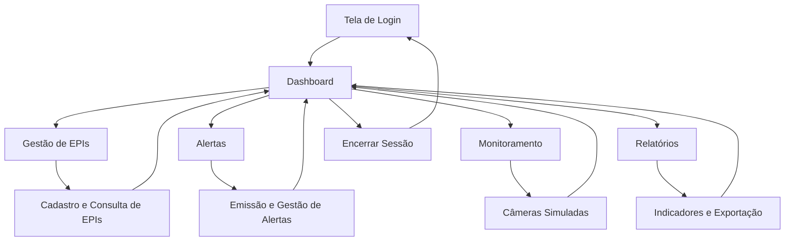

# 🎨 UX Design — SPI Alert | FutureVision

## Challenge de Engenharia de Software — Sprints 1, 2, 3 e 4

**Projeto:** SPI Alert — FutureVision  
**Contexto:** Metaindústria  
**Entrega:** Sprint 4 — Aplicação Final

---

# 1. Introdução

Este documento apresenta a proposta de User Experience (UX) e User Interface (UI) do SPI Alert — FutureVision, incluindo sua evolução ao longo das quatro Sprints.

O projeto busca facilitar o gerenciamento de Equipamentos de Proteção Individual (EPIs), o acompanhamento de alertas de risco e a consulta de informações relevantes para a segurança industrial.

A experiência foi concebida para oferecer uma interface clara, objetiva e acessível, reduzindo a complexidade de atividades operacionais e administrativas.

Na Sprint 4, o protótipo evoluiu para uma aplicação web demonstrativa com funcionalidades interativas, registros locais e atualização de indicadores.

---

# 2. Objetivos de UX

## 2.1 Objetivo Geral

Desenvolver uma experiência que facilite o acompanhamento das condições de segurança da Metaindústria, apoiando supervisores na identificação de irregularidades e na tomada de decisões.

## 2.2 Objetivos Específicos

- Facilitar o acesso às informações.
- Reduzir o número de etapas dos principais fluxos.
- Destacar ocorrências que exigem atenção.
- Organizar os dados de EPIs e alertas.
- Oferecer feedback após ações do usuário.
- Facilitar a consulta de indicadores.
- Manter consistência visual entre os módulos.
- Permitir utilização em diferentes tamanhos de tela.
- Diferenciar situações regulares, pendentes e críticas.

---

# 3. Personas dos Usuários

## 3.1 Persona 1 — Operador de Campo

**Nome:** Carlos Eduardo  
**Idade:** 34 anos  
**Papel:** Operador de Linha de Montagem / Célula Robotizada

### Perfil

Carlos Eduardo é um profissional focado em atingir as metas de produção de sua célula.

Possui uma rotina dinâmica, cansativa e trabalha diariamente com maquinário pesado.

### Necessidades

- Executar suas tarefas com produtividade.
- Trabalhar com segurança sem processos burocráticos excessivos.
- Evitar interrupções desnecessárias.
- Receber alertas relevantes e confiáveis.

### Dores

- Receio de sistemas de monitoramento estritamente punitivos.
- Possibilidade de advertências automáticas por pequenos deslizes.
- Alarmes falsos que interrompem a produção.
- Ferramentas que dificultam a rotina operacional.

### Expectativas de Experiência

Uma solução de segurança preventiva que não transforme o monitoramento em um mecanismo exclusivamente punitivo.

### Relação com a Aplicação Final

Carlos não é usuário direto da interface da Sprint 4.

Sua persona orienta o propósito da solução e a preocupação com uma experiência de segurança que respeite o contexto operacional.

---

## 3.2 Persona 2 — Supervisora de Segurança (SST)

**Nome:** Mariana Souza  
**Idade:** 29 anos  
**Papel:** Engenheira / Técnica de Saúde e Segurança do Trabalho

### Perfil

Mariana é responsável pelo acompanhamento da segurança nos três turnos de produção.

Sua rotina envolve auditorias, análise de ocorrências, orientação de operadores e identificação de riscos.

### Necessidades

- Identificar gargalos de segurança.
- Consultar a conformidade dos EPIs.
- Acompanhar alertas e situações pendentes.
- Acessar informações centralizadas.
- Gerar relatórios de acompanhamento.
- Apoiar ações preventivas.

### Dores

- Tempo gasto assistindo a gravações antigas de câmeras.
- Planilhas manuais de auditoria.
- Informações descentralizadas.
- Dificuldade para agir preventivamente.

### Expectativas de Experiência

Uma interface que reúna os dados mais importantes em um único ambiente, facilitando o acompanhamento e a priorização das ocorrências.

### Relação com a Aplicação Final

Mariana representa a usuária principal da aplicação demonstrativa.

Os módulos de dashboard, EPIs, alertas, monitoramento e relatórios foram organizados considerando suas atividades de supervisão.

---

# 4. Princípios de UX

## 4.1 Clareza

As informações devem ser apresentadas de forma objetiva, com títulos, indicadores e classificações compreensíveis.

## 4.2 Simplicidade

Os fluxos devem permitir que o usuário realize as principais tarefas com poucos passos.

## 4.3 Consistência

Menus, formulários, botões e mensagens devem manter padrões semelhantes entre as telas.

## 4.4 Visibilidade do Status

O usuário deve conseguir identificar a situação dos equipamentos e alertas.

## 4.5 Feedback

O sistema deve comunicar o resultado das ações, como cadastro de EPIs e emissão de alertas.

## 4.6 Prevenção de Erros

Os formulários devem exigir informações obrigatórias antes do registro.

## 4.7 Priorização

Informações de maior impacto para a segurança devem receber destaque visual.

---

# 5. Estrutura de Navegação

## 5.1 Arquitetura da Informação

A aplicação final foi organizada em cinco módulos principais:

1. Dashboard.
2. EPIs.
3. Alertas.
4. Monitoramento.
5. Relatórios.

O acesso inicial ocorre pela tela de login demonstrativo.

## 5.2 Mapa de Navegação

## 5.3 Justificativa

A navegação permite acessar as funcionalidades diretamente pelo menu principal.

Isso facilita o deslocamento entre atividades de consulta, registro e acompanhamento.

---

# 6. Jornada da Usuária Principal

## 6.1 Jornada — Mariana Souza

| Etapa | Objetivo da Usuária | Interação |
|---|---|---|
| 1 | Acessar o sistema | Login |
| 2 | Conhecer a situação geral | Dashboard |
| 3 | Verificar EPIs | Consulta de equipamentos |
| 4 | Registrar equipamento | Cadastro de EPI |
| 5 | Acompanhar ocorrências | Histórico de alertas |
| 6 | Registrar risco | Emissão de alerta |
| 7 | Concluir atendimento | Atualização do status |
| 8 | Consultar setores | Monitoramento demonstrativo |
| 9 | Analisar resultados | Relatórios |
| 10 | Finalizar o acesso | Sair |

## 6.2 Resultado Esperado

Permitir que Mariana realize atividades de acompanhamento e registro em um ambiente centralizado.

A aplicação demonstrativa não automatiza a identificação de riscos industriais, mas organiza os registros disponíveis para consulta e acompanhamento.

---

# 7. Fluxos de Experiência

## 7.1 Fluxo 1 — Acesso

### Objetivo

Permitir que o supervisor entre na aplicação.

### Etapas

1. Abrir o aplicativo.
2. Informar matrícula.
3. Informar senha.
4. Clicar em Entrar.
5. Visualizar o dashboard.

### Feedback

Caso algum campo esteja vazio, o sistema informa a necessidade de preenchimento.

### Limitação

A autenticação é demonstrativa e não verifica credenciais em servidor.

---

## 7.2 Fluxo 2 — Cadastro de EPI

### Objetivo

Registrar um equipamento vinculado a um colaborador.

### Etapas

1. Acessar EPIs.
2. Selecionar colaborador.
3. Selecionar equipamento.
4. Informar número do CA.
5. Informar validade.
6. Selecionar condição.
7. Registrar EPI.
8. Consultar o equipamento na tabela.

### Feedback

O sistema apresenta confirmação após o registro.

### Resultado Esperado

O equipamento passa a integrar a listagem e os dados armazenados localmente.

---

## 7.3 Fluxo 3 — Emissão de Alerta

### Objetivo

Registrar uma ocorrência de segurança.

### Etapas

1. Acessar Alertas.
2. Selecionar tipo de risco.
3. Definir severidade.
4. Informar setor.
5. Selecionar câmera.
6. Descrever a ocorrência.
7. Emitir alerta.
8. Consultar o novo registro.

### Feedback

A aplicação confirma o registro.

### Resultado Esperado

O alerta é criado com status Aberto e passa a integrar o histórico.

---

## 7.4 Fluxo 4 — Resolução de Alerta

### Objetivo

Atualizar uma ocorrência durante seu acompanhamento.

### Etapas

1. Acessar Alertas.
2. Localizar a ocorrência.
3. Selecionar Em análise, quando aplicável.
4. Selecionar Resolver.
5. Conferir a atualização dos indicadores.

### Resultado Esperado

O alerta deixa de ser contabilizado entre as ocorrências pendentes após sua resolução.

---

## 7.5 Fluxo 5 — Monitoramento

### Objetivo

Consultar os pontos de monitoramento cadastrados.

### Etapas

1. Acessar Monitoramento.
2. Visualizar as quatro câmeras simuladas.
3. Identificar seus setores.
4. Consultar a quantidade de alertas ativos por câmera.

### Resultado Esperado

Oferecer uma visualização consolidada das ocorrências associadas aos pontos de monitoramento.

### Limitação

Não existe transmissão de vídeo ao vivo nem identificação automática por inteligência artificial.

---

## 7.6 Fluxo 6 — Relatórios

### Objetivo

Consultar os indicadores de conformidade.

### Etapas

1. Acessar Relatórios.
2. Visualizar os indicadores.
3. Selecionar Exportar PDF / Imprimir.
4. Utilizar a opção Salvar como PDF do navegador.

### Resultado Esperado

Permitir a consulta e a exportação simplificada das informações demonstrativas.

---

# 8. Design de Interface — UI

## 8.1 Identidade Visual

A interface utiliza uma linguagem visual limpa, com cartões informativos, formulários organizados e botões de ação destacados.

O objetivo é permitir leitura rápida e facilitar a identificação das funcionalidades.

## 8.2 Paleta de Cores

| Cor | Utilização |
|---|---|
| Vermelho-terra / Laranja | Identidade principal e ações de destaque |
| Branco | Superfícies e cartões |
| Cinza-claro | Fundo e separação de áreas |
| Verde | Estados positivos e ações de resolução |
| Vermelho | Alertas e condições irregulares |
| Amarelo / Laranja-claro | Situações de atenção |

## 8.3 Componentes

### Botões

Utilizados para navegação, cadastros, atualizações e exportação de informações.

### Formulários

Organizados em campos com identificação textual e validação de preenchimento.

### Cards

Utilizados para indicadores, alertas e monitoramento.

### Tabelas

Utilizadas para apresentar registros de equipamentos.

### Indicadores de Status

Permitem diferenciar:

- Regular.
- Vencendo.
- Irregular.
- Aberto.
- Em análise.
- Resolvido.

## 8.4 Hierarquia Visual

A interface prioriza:

1. Identificação do módulo.
2. Informações e indicadores principais.
3. Formulários e ações.
4. Registros detalhados.

---

# 9. Evolução do UX ao Longo das Sprints

## 9.1 Sprint 1 — Concepção da Experiência

### Objetivo

Identificar as necessidades dos usuários e estruturar a proposta inicial de interação.

### Atividades

- Definição das personas.
- Identificação das principais dores.
- Levantamento dos fluxos.
- Estruturação do conceito visual.

### Resultado

Base inicial para o desenvolvimento do protótipo.

---

## 9.2 Sprint 2 — Refinamento do Protótipo

### Objetivo

Organizar a navegação e melhorar a apresentação das informações.

### Evoluções

- Refinamento das telas.
- Organização dos módulos.
- Detalhamento de formulários.
- Melhoria da hierarquia das informações.

### Resultado

Protótipo mais estruturado para demonstrar os principais processos do sistema.

---

## 9.3 Sprint 3 — Protótipo Interativo

### Objetivo

Ampliar os fluxos navegáveis e melhorar as interações.

### Evoluções

- Inclusão do fluxo de login.
- Inclusão do monitoramento demonstrativo.
- Melhoria da navegação.
- Implementação de busca.
- Implementação de filtros.
- Ajustes nos formulários.
- Melhorias nos estados selecionados.

### Resultado

Protótipo com maior capacidade de navegação e interação.

---

## 9.4 Sprint 4 — Aplicação Demonstrativa Funcional

### Objetivo

Consolidar as principais interações em uma aplicação web funcional.

### Evoluções

- Organização do sistema em módulos acessíveis pelo menu.
- Cadastro de EPIs com armazenamento local.
- Histórico de equipamentos.
- Emissão manual de alertas.
- Alteração do status das ocorrências.
- Dashboard calculado a partir dos registros.
- Monitoramento demonstrativo por câmera.
- Relatórios baseados nos dados disponíveis.
- Impressão ou salvamento em PDF.
- Opção de restauração dos dados.

### Decisão de UX

Na Sprint 4, a interface passou a priorizar a execução dos principais fluxos em um layout web responsivo, em vez de manter exclusivamente a apresentação do protótipo em formato de dispositivo móvel.

Essa decisão facilita a navegação e a demonstração em computadores.

### Resultado

Uma aplicação demonstrativa que permite executar atividades de gestão, e não apenas navegar por telas estáticas.

---

# 10. Comparação entre Protótipo e Aplicação Final

| Aspecto | Sprints Anteriores | Sprint 4 |
|---|---|---|
| Interface | Protótipo navegável | Aplicação web demonstrativa |
| Login | Fluxo simulado | Controle demonstrativo de sessão |
| EPIs | Navegação e formulários | Cadastro com armazenamento local |
| Alertas | Consulta e emissão simuladas | Registro e atualização de status |
| Dashboard | Informações de exemplo | Indicadores calculados |
| Monitoramento | Representação visual | Câmeras simuladas associadas a alertas |
| Relatórios | Visualização demonstrativa | Resumo calculado e impressão |
| Persistência | Interações de protótipo | LocalStorage |

---

# 11. Heurísticas de Usabilidade

A interface considera princípios gerais de usabilidade.

## 11.1 Visibilidade do Status

Apresentar claramente as situações dos EPIs e dos alertas.

## 11.2 Consistência

Manter padrões de navegação, nomenclatura e apresentação.

## 11.3 Prevenção de Erros

Utilizar campos obrigatórios e confirmação antes da restauração de dados.

## 11.4 Reconhecimento em Vez de Memorização

Apresentar opções disponíveis nos menus e formulários.

## 11.5 Eficiência

Facilitar o acesso direto às principais funcionalidades.

## 11.6 Feedback

Informar quando registros forem adicionados ou atualizados.

Esses princípios orientam o design, mas não representam, por si só, resultados de testes formais de usabilidade.

---

# 12. Acessibilidade e Melhorias Futuras

A evolução da interface poderá considerar:

- Navegação completa por teclado.
- Compatibilidade aprimorada com leitores de tela.
- Ampliação de áreas clicáveis.
- Mensagens de erro mais detalhadas.
- Revisão de contraste.
- Melhor adaptação a dispositivos móveis.
- Confirmações adicionais para ações críticas.
- Identificação textual independente das cores.
- Testes de acessibilidade com usuários reais.

---

# 13. Validação da Experiência — Sprint 4

## 13.1 Checklist de Testes

Antes da entrega, a equipe deverá verificar:

- [ ] Login e logout funcionam.
- [ ] O menu permite acessar todos os módulos.
- [ ] Os formulários indicam campos obrigatórios.
- [ ] O cadastro de EPI aparece na listagem.
- [ ] A busca de EPIs funciona.
- [ ] É possível emitir um alerta.
- [ ] É possível alterar o status do alerta.
- [ ] Os indicadores são atualizados.
- [ ] As câmeras simuladas são exibidas.
- [ ] Os relatórios apresentam os dados.
- [ ] A impressão em PDF funciona.
- [ ] Os dados permanecem após atualizar a página.
- [ ] O sistema apresenta informações compreensíveis.
- [ ] A interface pode ser utilizada em diferentes larguras de tela.

Os itens devem ser marcados somente após execução dos respectivos testes.

## 13.2 Resultados dos Testes

**Data:** [INSERIR DATA REAL]

**Responsáveis:** [INSERIR PARTICIPANTES]

**Problemas identificados:** [PREENCHER APÓS TESTES]

**Correções realizadas:** [PREENCHER APÓS CORREÇÕES]

**Pendências:** [INSERIR]

---

# 14. Limitações de Experiência

A aplicação demonstrativa possui algumas limitações:

- Não existe acesso individual real para operadores.
- Não existe autenticação corporativa.
- Não existe monitoramento ao vivo.
- Não há detecção automática de riscos.
- Os dados são armazenados apenas no navegador.
- Os relatórios são simplificados.
- Não foram apresentados resultados de testes formais com usuários reais.

Essas limitações devem ser consideradas na avaliação da maturidade do produto.

---

# 15. Propostas de Evolução do UX

Em uma futura implantação industrial, a experiência poderá evoluir com:

- Dashboard operacional em tempo real.
- Notificações automáticas.
- Histórico individual de colaboradores.
- Filtros avançados por setor, turno e risco.
- Identificação de ocorrências por câmera.
- Gestão de prioridades e responsáveis.
- Controle de acesso por perfil.
- Relatórios comparativos.
- Integração com equipamentos industriais.
- Experiência adaptada a supervisores e operadores.

---

# 16. Conclusão

A evolução de UX do SPI Alert — FutureVision acompanhou o desenvolvimento do produto durante as quatro Sprints.

O projeto partiu da identificação das necessidades de Carlos Eduardo e Mariana Souza, avançou para a construção de fluxos navegáveis e chegou a uma aplicação demonstrativa com funcionalidades de gestão.

A Sprint 4 priorizou a execução dos principais processos, a centralização de informações e a apresentação de indicadores.

A solução representa uma base para futuras evoluções em monitoramento industrial, integração de dados e prevenção automatizada de riscos.

---

## Documentos Relacionados

- [README.md](README.md)
- [REQUISITOS.md](REQUISITOS.md)
- [DIAGRAMAS.md](DIAGRAMAS.md)
- [ARQUITETURA_FINAL.md](ARQUITETURA_FINAL.md)
- [CERIMONIAS_SCRUM.md](CERIMONIAS_SCRUM.md)
- [Aplicação HTML](spi-prototipo.html)

**SPI Alert — FutureVision | UX Design — Sprint 4**
